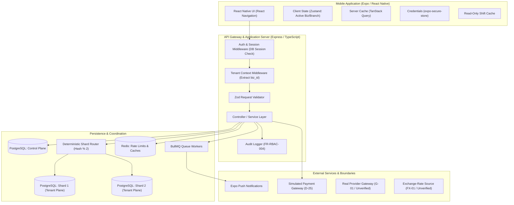
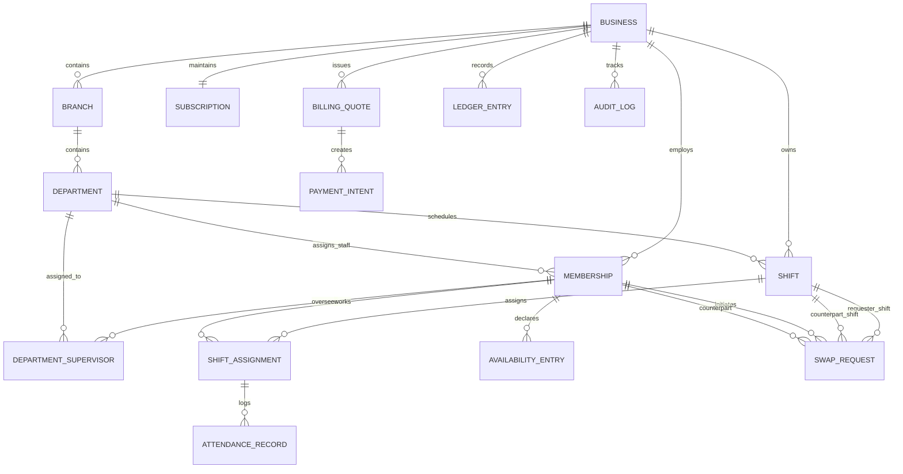

# Rota: System Architecture & Technical Design

## 1. Executive Summary & Vision
Rota is a multi-tenant mobile workforce scheduling platform designed for shift-based businesses (`PRD 1`). The platform isolates every business's operational and financial data while allowing users with a single global identity to participate in multiple businesses (`D-01`).

This document details the software architecture, component boundaries, data plane separation, and persistence patterns planned for implementation across Milestones M1 through M10.

---

## 2. High-Level System Architecture

---

## 3. Technology Stack Reference

| Tier | Technology | Purpose | Decision Reference |
|---|---|---|---|
| **Mobile Client** | React Native (Expo SDK 58, Dev Build) | Cross-platform iOS/Android app | `DR-08` |
| **Mobile Navigation** | React Navigation (Native Stack + Bottom Tabs) | Deterministic navigation resets and deep link interceptors | `DR-08` |
| **Client State** | TanStack Query v5 + Zustand | Server cache + client session context | `DR-06` |
| **Secure Storage** | `expo-secure-store` | Hardware-backed JWT/refresh token storage | `DR-05`, `FR-AUTH-009` |
| **Backend Runtime** | Node.js (v20+ LTS) with TypeScript | Strongly typed server runtime | `PRD 12.6` |
| **HTTP Framework** | Express 5 with async handlers | Raw-body webhook parsing and standard middleware | `DR-02` |
| **Request Validation** | Zod | Boundary schema validation and type inference | `SEC-003` |
| **Database** | PostgreSQL 16 | ACID database, forced RLS, simulated sharding | `DR-04`, `DR-07` |
| **Database Access** | Kysely + `pg` (node-postgres) | Type-safe SQL builder with explicit transaction control | `DR-07` |
| **Migrations** | `node-pg-migrate` | Declarative raw SQL migrations for RLS & triggers | `DR-07` |
| **Cache & Limiter** | Redis 7 | Caching, fail-closed rate limiting, BullMQ backend | `PRD 12.6`, `NFR-REL-002` |
| **Background Jobs** | BullMQ + Dual-layer PostgreSQL inboxes | Durable webhook ingestion & notification fan-out | `DR-03` |
| **Password Hashing** | Argon2id | Memory-hard cryptographic hashing | `SEC-008` |

---

## 4. Plane Separation and Data Architecture

The architecture enforces a strict boundary between two data planes (`PRD 9.1`):

### 4.1 Control Plane (Unsharded Schema: `rota_control`)
Data required prior to determining tenant context or spanning multiple businesses:
- `users`: Global identities, email verification, Argon2id password hashes (`FR-AUTH-001`).
- `auth_identities`: OAuth provider linkages (`FR-AUTH-011`, Gate `G-02`).
- `sessions`: Active device sessions, revocation timestamps, refresh token family root (`FR-AUTH-005`).
- `refresh_tokens`: Hashed refresh tokens (`token_hash`), parent linkages, family ID (`FR-AUTH-004`).
- `devices` & `push_tokens`: Device registrations and push notification endpoints (`FR-NOT-002`).
- `user_settings` & `notification_preferences`: Per-field sync settings (`FR-SET-005`).
- `membership_directory`: Read-only copy of `(user_id, business_id, role, status)` populated via outbox to speed up login business listings without cross-shard joins (`AC-TEN-07`).
- `payment_events`: Durable, append-only webhook event inbox (`BILL-007`).
- `deletion_requests`: Account erasure pipeline records (`PRIV-001`).

### 4.2 Tenant Plane (Two Simulated Shards: `rota_shard_1`, `rota_shard_2`)
All data owned by a business is stored on exactly one logical shard determined by `hash(business_id) % 2`:
- `businesses`: Tenant root, business name, IANA time zone (`FR-SCH-007`).
- `branches`: Physical locations/branches (`PRD 19.2`, `D-32`).
- `departments`: Branch-owned units (Checkout, Inventory, etc.) (`D-33`).
- `memberships`: User participation in a business with role (`Owner`, `GM`, `Supervisor`, `Staff`) and assigned `branch_id`/`department_id`.
- `department_supervisors`: Explicit supervisor assignments to departments (`D-18`, `C-06`).
- `invitations`: Dual-channel invitation records (links and codes sharing the same single-use token hash) (`D-26`, `Section 19.6`).
- `shifts`: Department-scoped shifts storing UTC start/end times and optimistic `version` (`FR-SCH-007`, `FR-SWP-007`).
- `staffing_requirements`: Wall-clock recurring headcount requirements (`FR-SCH-009`).
- `shift_assignments`: Member assignments to published shifts with reasoned overrides (`FR-AVL-003`).
- `availability_entries`: Staff weekly availability and preference windows (`FR-AVL-001`).
- `swap_requests`: Three-stage peer shift swaps with stale version detection (`FR-SWP-001` to `007`).
- `attendance_records`: Manager attendance logging (`present`, `late`, `absent`) (`FR-ATT-001`).
- `subscriptions`: Authoritative tier state, seat quantities, scheduled changes, and version (`BILL-009`, `C-11`).
- `billing_quotes`: Server-calculated, expiring, single-use price quotes (`BILL-013`).
- `payment_intents`: Open payment tracking tied to quotes (`BILL-022`).
- `ledger_entries`: Append-only, trigger-protected financial history (`C-08`, `BILL-010`).
- `audit_log`: Record of privileged security actions and denied attempts (`FR-RBAC-004`).
- `notification_deliveries`: Deduplicated push/in-app delivery records (`FR-NOT-010`).

---

## 5. Entity Relationship Model (ERD)

---

## 6. Key Request & Data Flows

### 6.1 Tenant Context Resolution Sequence
1. Client issues request with `Authorization: Bearer <access_token>`.
2. `AuthMiddleware` verifies JWT signature and extracts `userId` and `businessId`.
3. Middleware queries `sessions` and `memberships` to verify session is active and membership is not suspended/deactivated (`FR-RBAC-006`).
4. `TenantMiddleware` checks out a connection from the assigned shard pool (`hash(businessId) % 2`).
5. Transaction executes `SET LOCAL app.current_business_id = '<businessId>';`.
6. PostgreSQL RLS policies evaluate `business_id = current_setting('app.current_business_id')` on every row.
7. Connection is committed and returned to the pool with context cleared (`AC-TEN-04`).

### 6.2 Atomic Seat Admission Flow (`BILL-009`, `BR-007`)
1. Invitee submits acceptance with single-use invitation token.
2. Server opens transaction on the business's shard connection.
3. Lock subscription: `SELECT * FROM subscriptions WHERE business_id = $1 FOR UPDATE;`.
4. Count active memberships: `SELECT COUNT(*) FROM memberships WHERE business_id = $1 AND status = 'active';`.
5. Compute `admission_limit = min(seat_quantity, scheduled_seat_quantity)`.
6. If `count >= admission_limit`:
   - Roll back transaction.
   - Enqueue urgent notification to Owners (`AC-INV-09`).
   - Return HTTP 409 `SEAT_LIMIT_REACHED`.
7. If `count < admission_limit`:
   - Insert new membership and mark invitation accepted.
   - Commit transaction atomically.

---

## 7. Cost & Service Footprint (`NFR-COST-001`)

The design relies entirely on open-source, locally runnable software and free-tier external dependencies suitable for a graduation project:
- **Database**: Single local PostgreSQL instance hosting control and simulated shard schemas.
- **Cache & Queue**: Single local Redis instance.
- **Push Notifications**: Expo Push Notification service (free tier).
- **Error Tracking**: Sentry (free developer tier proposed, `FR-OPS-002`).
- **Load Testing**: k6 local test runner (`FR-OPS-004`).
