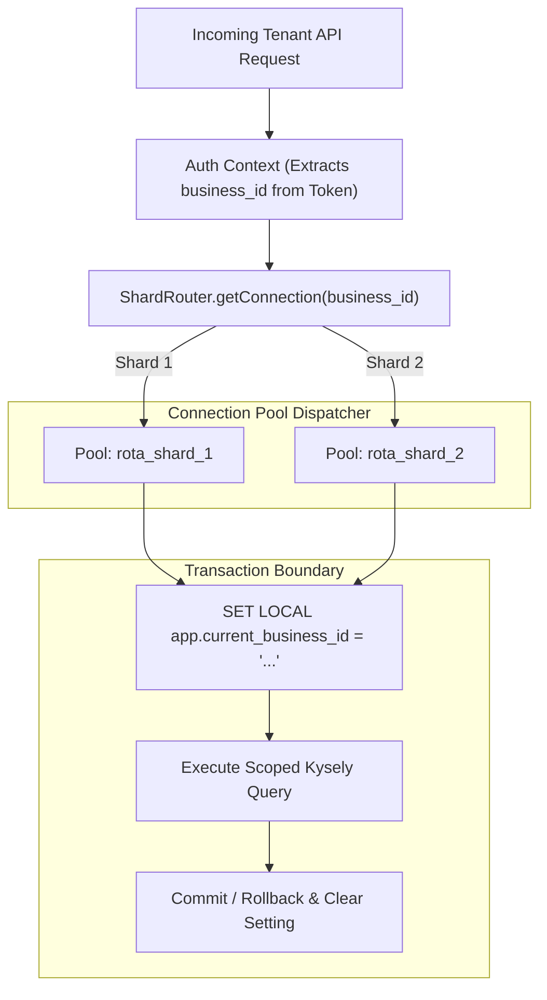

# Rota: Two-Logical-Shard Simulation Architecture

## 1. Architectural Overview and Simulation Boundary
Per Decision `D-30`, `PRD 9.1`, and `NFR-SCALE-002`, Rota implements a simulation of two logical tenant-plane database shards:
- **Logical Simulation Invariant**: The two shards (`rota_shard_1` and `rota_shard_2`) represent independent logical tenant planes. In development and testing, they operate as distinct PostgreSQL schemas or databases within the same PostgreSQL instance. This satisfies all architectural sharding and routing requirements without introducing distributed physical infrastructure overhead (`D-29`, `AGENTS.md` line 77).
- **Control Plane Separation**: The control plane (`rota_control`) is unsharded. Global identities, sessions, devices, and the payment event inbox reside here.

---

## 2. Shard Key and Hash Routing Strategy

### 2.1 The Shard Key
The authoritative shard routing key is **`business_id` (UUIDv4)** (`C-01`, `SEC-013`).
Every tenant-plane table includes `business_id NOT NULL`. Queries targeting tenant data require an active `business_id`.

### 2.2 Deterministic Hash Function
To guarantee stable, uniform routing, Rota uses a deterministic hash algorithm:
```typescript
import { createHash } from 'crypto';

export function getShardIdForBusiness(businessId: string): 'shard_1' | 'shard_2' {
  if (!businessId) {
    throw new Error('business_id is required for shard routing');
  }
  // MD5 or SHA-256 hash converted to 32-bit unsigned integer
  const hash = createHash('sha256').update(businessId.toLowerCase().trim()).digest();
  const numericValue = hash.readUInt32BE(0);
  const shardIndex = numericValue % 2;
  return shardIndex === 0 ? 'shard_1' : 'shard_2';
}
```

### 2.3 Verification Criteria
- **Stability (`AC-SH-01`)**: Running `getShardIdForBusiness(id)` 1,000 times for the same UUID returns the exact same shard 100% of the time, across server restarts.
- **Distribution Balance (`AC-SH-02`)**: Over 1,000 randomly generated UUIDs, each shard receives at least 40% of the tenant allocations (targeting ~50/50 balance).

---

## 3. Shard Dispatch and Connection Pool Wrapper



- When a tenant request enters the system, `TenantMiddleware` queries the router for the assigned pool.
- The connection checks out, executes `SET LOCAL app.current_business_id = '<businessId>';`, executes the query, and cleans the session upon returning to the pool (`AC-TEN-04`).
- **Data Isolation Guarantee (`AC-SH-03`)**: Every row for a business exists solely on its assigned shard. A direct SQL query against the other shard returns zero rows.

---

## 4. Cross-Shard Operations and Cost Analysis (`AC-SH-04`)

Cross-shard joins are strictly forbidden by database architecture. Operations spanning multiple tenants are handled through the following architectural patterns:

| Cross-Shard Operation | How It Is Resolved | Architectural Cost & Trade-off |
|---|---|---|
| **Login Business Listing** | User logs in and needs a list of all businesses they belong to across both shards. | **Low Cost**: Resolved via control-plane `membership_directory` copy. No tenant shard queries are executed at login (`D-01`). |
| **Directory Synchronization** | Tenant creates/deactivates a membership; directory copy must update. | **Medium Cost**: Uses transactional outbox on tenant shard + background reconciliation job. Asynchronous, resilient to transient failures (`AC-TEN-07`). |
| **Global Push Notification Dispatch** | Background worker needs to deliver notifications across tenants. | **Medium Cost**: Control plane `push_tokens` are queried; tenant data lookups are batched per tenant shard with re-established tenant context (`SEC-018`). |
| **System Admin Reporting** | Aggregate metrics across all tenants. | **High Cost (Acceptable)**: Admin maintenance jobs run sequential fan-out queries across `shard_1` and `shard_2` and aggregate results in memory. Never runs on critical user paths. |

---

## 5. Large-Tenant Skew and Limitations (`AC-SH-05`)

1. **Shard Imbalance**: A business with high transaction volume (e.g. 10,000 activity feed rows, dozens of shifts per week) creates shard storage and CPU skew. The simulation test suite includes a skew test seeding 10,000 rows to observe distribution and reporting (`AC-SH-05`).
2. **Mitigation in V1**: Activity feeds are cursor-paginated with composite indexes `(business_id, created_at, id)` and audience filtering indexes (`FR-ACT-006`), ensuring queries remain under 50ms regardless of shard size.

---

## 6. Dual-Shard Migrations and Drift Prevention (`AC-SH-06`)

Migrations run through a unified runner:
1. `npm run db:migrate` applies migrations to `rota_control`.
2. The runner connects to `rota_shard_1` and runs the tenant migration suite.
3. The runner connects to `rota_shard_2` and runs the tenant migration suite.
4. An automated schema drift inspection compares table definitions between `shard_1` and `shard_2` and reports any schema asymmetry.
