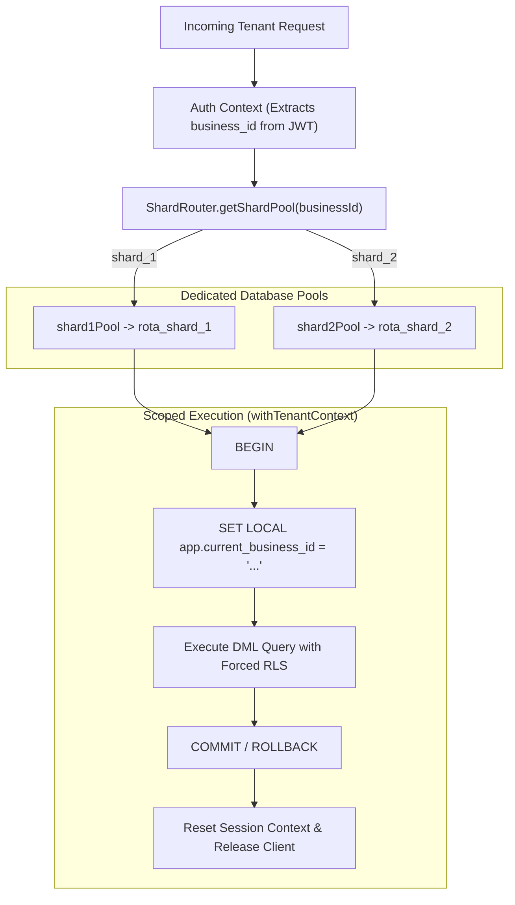

# Rota: Two-Shard Database Architecture & Multi-Tenant Routing (Phase 2)

## 1. Architectural Overview & Physical Database Separation
Per `PRD 9.1`, `DR-04`, `SEC-013`, and **Phase 2 Implementation**, Rota provisions two separate physical PostgreSQL tenant databases alongside the unsharded control-plane database:
- **Control Plane (`rota`)**: Contains the `rota_control` schema housing global identities (`users`), refresh tokens (`refresh_tokens`), global membership directory (`membership_directory`), mobile push tokens (`push_tokens`), and system audit logs.
- **Physical Shard 1 (`rota_shard_1`)**: Dedicated PostgreSQL database storing tenant organizations, branches, departments, memberships, shifts, shift assignments, activity events, inbox items, and financial ledger for tenants mapped to Shard 1. All tenant tables enforce forced Row-Level Security (`FORCE ROW LEVEL SECURITY`).
- **Physical Shard 2 (`rota_shard_2`)**: Dedicated PostgreSQL database completely physically separate from Shard 1, storing identical symmetrical tenant structures for tenants mapped to Shard 2 with forced Row-Level Security.

Connection URLs are explicitly partitioned:
- `DATABASE_URL`: Admin DDL/migration connection to `rota` control database.
- `APP_DATABASE_URL`: Least-privilege `rota_app` application connection to `rota` control database.
- `SHARD_1_DATABASE_URL` / `APP_SHARD_1_DATABASE_URL`: Dedicated admin and application connections to `rota_shard_1`.
- `SHARD_2_DATABASE_URL` / `APP_SHARD_2_DATABASE_URL`: Dedicated admin and application connections to `rota_shard_2`.

---

## 2. Tenant Boundary Parity: `business_id` and `team_id`
In Rota's multi-tenant domain model:
- **`business_id`** is the canonical database and schema tenant boundary identifier representing the organization/business entity.
- **`team_id`** is the user-facing workforce and scheduling context (e.g. `TeamScreen`, `team-management.test.ts`).
- **Parity Finding**: `business_id` and `team_id` represent the **exact same tenant boundary**. An organization corresponds 1:1 with its team workspace.
- **Router Aliases**: To guarantee complete compatibility, `src/sharding/shard-router.ts` exports:
  ```typescript
  export const getShardIdForTeam = getShardIdForBusiness;
  export const validateTeamId = validateBusinessId;
  export const getSchemaForTeam = getSchemaForBusiness;
  ```

---

## 3. Shard Key and Hash Routing Strategy

### 3.1 The Shard Key
The authoritative routing key is **`business_id` (UUIDv4)** (`C-01`, `SEC-013`). Every tenant-plane table includes `business_id NOT NULL`.

### 3.2 Deterministic Hash Function
Routing follows `PRD 9.1` using SHA-256 modulo 2:
```typescript
import { createHash } from 'node:crypto';

export function getShardIdForBusiness(businessId: string): 'shard_1' | 'shard_2' {
  validateBusinessId(businessId);
  const normalized = businessId.trim().toLowerCase();
  const digest = createHash('sha256').update(normalized).digest();
  const numericValue = digest.readUInt32BE(0);
  return numericValue % 2 === 0 ? 'shard_1' : 'shard_2';
}
```

### 3.3 Verification Criteria
- **Stability (`AC-SH-01`)**: Running `getShardIdForBusiness(id)` 1,000 times for the same UUID returns the exact same shard 100% of the time, across server restarts.
- **Distribution Balance (`AC-SH-02`)**: Over 1,000 randomly generated UUIDs, each shard receives at least 40% of the tenant allocations (~50/50 balance).

---

## 4. Connection Pools and Tenant Context Dispatch



- When a tenant request executes via `withTenantContext(businessId, callback)`:
  1. The target pool is checked out (`shard1Pool` for `rota_shard_1` or `shard2Pool` for `rota_shard_2`).
  2. Transaction begins with `SET LOCAL app.current_business_id = '<business_id>'`.
  3. Row-Level Security policies filter and protect all table operations.
  4. On return to pool, `set_config('app.current_business_id', '', false)` clears session state to prevent connection pooling poisoning (`AC-TEN-04`).

---

## 5. Read/Write Routing and Read-Your-Own-Writes (RYOW)

### 5.1 Routing Model
All read and write operations for a tenant route to the **authoritative primary shard database** assigned to that tenant:
- Writes execute directly against the primary shard database inside a transaction.
- Reads execute directly against the primary shard database connection pool.

### 5.2 Read-Your-Own-Writes Guarantee
Because both reads and writes check out connections from the authoritative primary shard database connection pool, **Read-Your-Own-Writes is strictly and immediately guaranteed**:
- A transaction that inserts or updates a shift, membership, or setting is immediately readable on subsequent queries without replication lag.
- Verified in `tests/sharding/separate-shard-databases.test.ts`.

### 5.3 Database Replicas & Limitations
- **No Asynchronous Replicas**: Database replicas are intentionally omitted. Distributing load across two physical shard databases (`rota_shard_1` and `rota_shard_2`) provides horizontal scalability without the consistency penalties of asynchronous replication lag.
- **Remaining Limitation**: Reads cannot scale beyond primary shard database capacity without replicas or further shard division. In the event of future read-replica deployment, WAL replication lag would require sticky sessions or LSN-based read routing to preserve RYOW.

---

## 6. Redis Caching Layer & Invalidation

### 6.1 Tenant-Isolated Keys
Cache keys enforce strict tenant partitioning:
- **Format**: `tenant:{businessId}:{key}` (e.g. `tenant:uuid:schedule:Manager:all:all:published`, `tenant:uuid:roster:members`).
- Cross-tenant data leakage is cryptographically impossible via key isolation (`SEC-014`, `AC-TEN-05`).

### 6.2 Write-Through Invalidation
- **Schedule Invalidation**: Creating, updating, assigning, unassigning, publishing, or deleting shifts calls `cacheService.invalidatePrefix(businessId, 'schedule')`.
- **Roster Invalidation**: Inviting members, accepting invitations, updating roles, removing members, or transferring ownership calls `cacheService.invalidatePrefix(businessId, 'roster')`.
- Redis invalidation utilizes non-blocking cursor-based `SCAN` + `DEL` to prevent Redis event loop stalls.

### 6.3 Safe Cache Bypass & Fault Tolerance
- When Redis is disconnected, unavailable, or experiencing network latency, `cacheService.get` catches errors, logs structured warnings, and returns `null` or falls back to local memory.
- The application automatically **bypasses the cache and reads directly from PostgreSQL**.
- **Security-Critical Fail-Closed Behavior**: Rate limiting, JWT refresh token revocation families, and distributed queue locking maintain strict fail-closed security semantics.

---

## 7. Mobile Foreground Settings Refresh
In `mobile/src/screens/SettingsScreen.tsx`, a React Native `AppState` event listener detects when the application transitions from background to foreground:
```typescript
useEffect(() => {
  loadInfo();

  const subscription = AppState.addEventListener('change', (nextAppState: AppStateStatus) => {
    if (nextAppState === 'active') {
      loadInfo();
    }
  });

  return () => {
    subscription.remove();
  };
}, []);
```
- **Device-Controlled Light/Dark Mode Preservation**: The mobile theme system strictly derives appearance from `useColorScheme()` and `Appearance.addChangeListener` in `ThemeContext.tsx`. Foreground settings refresh synchronizes user preferences, notifications, and profile details without altering system-controlled appearance.

---

## 8. Backup and Rollback Procedure

Before shard separation, an authoritative backup was captured and verified:
- **Location**: `backups/pre-shard-separation-backup-2026-10-24T22-22-33-589Z.json`
- **Total Tables**: 51 tables across `rota_control`, `rota_shard_1`, and `rota_shard_2`.
- **Total Rows**: 33,052 verified records.
- **Rollback Tooling**: `scripts/restore-from-backup.ts` allows zero-loss transactional restoration in the event of hardware or cluster failure.

---

## 9. Large-Team Handling, Indexing & Scaling Considerations

### 9.1 Composite B-Tree Indexing
Rota anticipates high-volume tenants (organizations with thousands of shifts, shift assignments, and activity events) by enforcing composite indexes on all tenant-plane tables where `business_id` is the leading column:
- `activity_events`: `idx_activity_events_feed ON activity_events(business_id, created_at DESC, id DESC)`
- `shifts`: `idx_shifts_dept_starts ON shifts(business_id, department_id, starts_at)`
- `shift_assignments`: `idx_assignments_member ON shift_assignments(business_id, membership_id)` and `idx_assignments_shift ON shift_assignments(business_id, shift_id)`
- `attendance_records`: `idx_attendance_membership ON attendance_records(business_id, membership_id, recorded_at)`

Because every query includes `business_id = $1` enforced both by application services and PostgreSQL `FORCE ROW LEVEL SECURITY`, B-tree lookups immediately prune non-matching index branches. As proven in `scripts/benchmark-explain-10k.ts` and `docs/reports/RELEASE-EVIDENCE.md`, querying across 10,000 seeded events executes an index scan in **0.168 ms** with only 3 shared buffer hits, avoiding sequential scans and sort memory overhead.

### 9.2 Keyset Cursor Pagination
For deep timeline listings such as the activity feed (`src/services/activity-service.ts`), Rota strictly avoids offset-based pagination (`OFFSET N`). In large teams, high offsets force the database engine to traverse and discard thousands of rows. Instead, Rota implements deterministic keyset cursor pagination:
```sql
WHERE business_id = $1
  AND (
    created_at < $cursorCreatedAt
    OR (created_at = $cursorCreatedAt AND id < $cursorId)
  )
ORDER BY created_at DESC, id DESC
LIMIT $limit + 1;
```
This guarantees constant-time $O(1)$ page traversal regardless of page depth, with zero degradation as historical events accumulate.

### 9.3 Capacity Limits & Scaling Considerations
- **Current Shard Capacity Ceiling**: Because the shard key is `business_id`, an entire organization and all its historical records reside on a single shard database node. An individual organization cannot be split across multiple shard databases. Therefore, the absolute operational capacity of any single team is bounded by the vertical resources (CPU, RAM, disk IOPS) of its assigned shard node.
- **Future Scaling Strategies (Beyond Graduation Baseline)**:
  1. *Vertical Scaling*: Increasing CPU, RAM, and NVMe IOPS on the shard node.
  2. *Single-Tenant Dedicated Shards*: High-volume enterprise customers can be bypassed around the hash function and assigned a dedicated physical PostgreSQL instance.
  3. *Table Partitioning*: Sub-partitioning high-volume tables (e.g. `shifts` and `activity_events`) by range (monthly or quarterly `created_at` intervals) within the tenant shard to maintain active working sets entirely in RAM cache.

---

## 10. Difficult Cross-Shard Queries & Mitigation Strategy

### 10.1 Queries That Are Difficult Across Physically Separate Shards
In a multi-database sharded architecture, standard SQL operations cannot cross database connection boundaries:
1. **User Multi-Organization Discovery**: A global identity in `rota_control.users` can belong to multiple businesses. If organization memberships were stored solely on the shard databases, finding all businesses a user belongs to upon login would require an expensive fan-out broadcast query to every physical shard database (`rota_shard_1`, `rota_shard_2`, and future shards), waiting for all shards to respond and merging results. A single slow or unavailable shard would fail the entire login request.
2. **Platform-Wide Aggregate Analytics**: Generating global administrative reports (e.g. total platform shifts scheduled, total revenue by month, platform-wide seat utilization) cannot be executed via SQL joins or aggregates across shard boundaries.
3. **Cross-Tenant Workforce Movements**: Transferring a worker or shift between two separate businesses located on different shards cannot be performed inside a single ACID database transaction without two-phase commit (2PC).

### 10.2 How Rota Handles or Avoids These Queries
- **Control-Plane Global Directory (`membership_directory`)**:
  Rota avoids cross-shard login fan-out entirely by maintaining a synchronized `membership_directory` table in the unsharded control plane database (`rota_control` schema):
  ```sql
  -- Look up user's active businesses in O(1) time without querying any shard
  SELECT business_id, business_name, role, status
  FROM membership_directory
  WHERE user_id = $1 AND status = 'active';
  ```
- **Transactional Outbox Synchronization (`outbox-service.ts`)**:
  When membership state changes on a shard (member invited, invitation accepted, role modified, member removed), the mutation is written inside the shard transaction and synchronized to `membership_directory` on the control plane.
- **Intra-Organization Domain Boundary Enforcement**:
  Rota's business rules explicitly forbid cross-tenant operations. Shift scheduling, availability overrides, peer shift swaps, and attendance are strictly intra-organization (`business_id`-scoped). Because cross-organization shift swaps are structurally disallowed, two-phase commit (2PC) and distributed transactions are completely unnecessary.

---

## 11. Limitations and Trade-offs of the Chosen Shard Key (`business_id`)

### 11.1 Shard Key Selection Rationale
`business_id` (UUIDv4) is the canonical shard routing key. Every table in the tenant plane contains `business_id NOT NULL` as part of its composite primary key and foreign keys.

### 11.2 Trade-offs and Advantages
- **Single-Shard Request Isolation**: 100% of core operational requests (viewing schedules, booking shifts, approving swaps, querying activity feeds, checking attendance) execute entirely within a single database. Zero distributed joins or distributed transactions are required.
- **Flawless Row-Level Security**: Row-Level Security (`FORCE ROW LEVEL SECURITY`) and transaction scoping (`SET LOCAL app.current_business_id`) operate with strict certainty on a single connection.
- **Zero Routing State**: Deterministic hashing (`SHA-256 % 2`) requires no external routing tables or distributed consensus.

### 11.3 Limitations
- **Lumpy Tenant Distribution ("Noisy Neighbor" Risk)**:
  Deterministic hash routing guarantees statistical balance in the **number of businesses** assigned to each shard (~50/50 over 1,000 UUIDs as verified by `AC-SH-02`), but does **not** account for tenant **size or activity**. If multiple high-concurrency enterprise tenants happen to hash to `rota_shard_1`, Shard 1 will experience significantly higher CPU and IOPS utilization than Shard 2.
- **Tenant Size Ceiling**:
  A single tenant cannot scale horizontally across multiple database nodes. If an organization outgrows a single PostgreSQL node, it must either scale vertically or be isolated onto a dedicated instance.
- **Re-sharding Penalty with Fixed Modulo**:
  The current hash formula `SHA-256(business_id) % 2` relies on a fixed modulus of 2. Scaling from 2 shards to 3 shards would invalidate approximately 66% of tenant-to-shard assignments, requiring extensive offline data migration. In a future major version, consistent hashing (a hash ring with virtual nodes) or a shard directory mapping table will be introduced to allow incremental node additions without full reshuffling.

